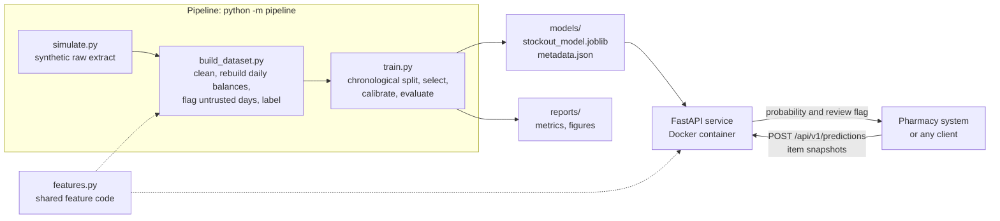

# PharmaSight: 7-day stockout early warning

DSA 8401 Applied Machine Learning capstone, MSc Data Science & Analytics, Strathmore University.
Author: Nelson Mwangi.

Each morning a hospital pharmacist has time to check a handful of items, not the whole formulary. This project
predicts, for every item that is in stock at the start of the day, the probability that it runs out within the
next 7 days, so the pharmacist can check the riskiest items first. It is a scripted pipeline (raw extract to
trained model) and a FastAPI service in Docker that returns a risk score and a review flag per item.

**The data is synthetic.** The pipeline was designed for a Kenyan hospital pharmacy's dispensing, stock-movement
and purchase-order records, which cannot be published. `pipeline/simulate.py` generates tables with the same
structure and the same recording problems: pack units, reversed lines, duplicate exports, system outages, late
receipts, unrecorded losses and censored demand. No hospital or patient records are in this repository. The
full write-up, including why synthetic data and what that limits, is in [REPORT.md](REPORT.md).

## Results on the held-out test period

Test period November 2025 to February 2026: 3,658 item-days, 94 stockout episodes. Every number below is
produced by `python -m pipeline` and saved in [reports/metrics.json](reports/metrics.json).

| Model | Average precision (95% CI) | ROC AUC | Precision of top-5 daily alerts | Episodes warned at 5 alerts/day |
|---|---|---|---|---|
| Days-of-stock rule (baseline) | 0.36 (0.28 to 0.45) | 0.84 | 0.38 | 66 of 94 |
| Logistic regression (deployed, calibrated) | 0.52 (0.43 to 0.61) | 0.87 | 0.46 | 66 of 94 |
| Gradient-boosted trees | 0.50 (0.41 to 0.62) | 0.88 | 0.44 | 63 of 94 |

The model ranks risk better than days of stock alone. At five reviews a day it warns of the same share of
episodes as the rule, but fewer of its alerts are wasted. The report covers what that means in practice.

## Architecture



With real data, a read-only extract job writing the same five tables replaces `simulate.py`. Nothing downstream
changes. The API builds features with the same `features.py` the training data used, so a request cannot be
featurised differently from the training rows.

## Repository layout

```
pipeline/            data pipeline and training
  simulate.py        synthetic extract: items, opening balances, dispensing, movements, purchase orders
  build_dataset.py   cleaning, daily balance reconstruction, trust flags, features, labels
  features.py        snapshot fields and model features, shared with the API
  train.py           split, model selection, calibration, test evaluation, figures, artifacts
  config.py          dates, horizon, alert capacity, seed
app/                 FastAPI service (main.py, model.py, schemas.py, security.py)
models/              trained model and its metadata, committed
reports/             metrics.json, data_quality.json, model_selection.csv, figures/
tests/               pipeline leakage and label tests, API tests
examples/            a sample request
REPORT.md            final report
AI_USE.md            AI assistance disclosure
```

## Run the API with Docker

Needs Docker with Compose.

```bash
git clone https://github.com/MwangiNelson/pharmasight-stockout.git
cd pharmasight-stockout
docker compose up -d --build api
curl http://localhost:8000/api/v1/health
curl -X POST http://localhost:8000/api/v1/predictions \
     -H "X-Api-Key: dev-key-change-me" -H "Content-Type: application/json" \
     -d @examples/request.json
```

Interactive docs are at http://localhost:8000/docs. Click "Authorize" and enter the API key to try the
prediction endpoint from the browser. Stop with `docker compose down`.

## Reproduce everything from scratch

The pipeline is deterministic (seed 8401) and takes about a minute and a half.

With Python 3.11 or newer:

```bash
python -m venv .venv
source .venv/bin/activate          # Windows: .venv\Scripts\activate
pip install -r requirements.txt
python -m pipeline                 # simulate -> build_dataset -> train
pytest -q
uvicorn app.main:app --port 8000   # serve the model you just trained
```

Or inside Docker, writing results back to `data/`, `models/` and `reports/` on your machine:

```bash
docker compose --profile pipeline run --rm pipeline
docker compose up -d --build api   # rebuild so the image carries the new model
```

Each step also runs on its own: `python -m pipeline.simulate`, `python -m pipeline.build_dataset`,
`python -m pipeline.train`.

## API

| Method | Path | Auth | Returns |
|---|---|---|---|
| GET | `/api/v1/health` | none | service and model version |
| GET | `/api/v1/model` | none | features, review threshold, training data, headline test metrics |
| POST | `/api/v1/predictions` | `X-Api-Key` header | risk for 1 to 1,000 items, highest first |

Each item in the request describes one medicine at the start of a day, in base units (tablets, vials, bottles):

| Field | Required | Meaning |
|---|---|---|
| `item_id` | yes | your identifier, echoed back |
| `as_of` | yes | the day being predicted for (ISO date) |
| `stock_on_hand` | yes | usable stock at the start of the day; must be above zero |
| `dispensed_last_7d`, `dispensed_last_28d` | yes | total dispensed over the previous 7 and 28 days |
| `dispensing_std_28d` | no | standard deviation of daily dispensing over 28 days |
| `outstanding_order_qty` | no | ordered and not yet received |
| `oldest_open_order_age_days` | no | age of the oldest open order; empty when none |
| `days_since_last_order` | no | days since an order was last placed |
| `recent_lead_time_days` | no | mean lead time of the last three deliveries |
| `stockout_days_last_90d` | no | days at zero stock in the previous 90 |
| `days_since_last_stockout` | no | empty when none on record |

Response:

```json
{
  "model_version": "20261119",
  "horizon_days": 7,
  "review_threshold": 0.3674,
  "predictions": [
    {"item_id": "MED-007", "as_of": "2026-02-02", "stockout_probability": 0.4384, "review": true, "days_of_stock": 2.7}
  ]
}
```

`review` is true when the probability reaches a threshold set on the validation period, where it raised about
five alerts a day (four a day on the test period). The service rejects requests for items already at zero stock, and histories where
the 7-day total exceeds the 28-day total.

## Configuration

Copy `.env.example` to `.env` and set:

| Variable | Default | Purpose |
|---|---|---|
| `API_KEYS` | `dev-key-change-me` | comma-separated keys accepted in `X-Api-Key` |
| `APP_ENV` | `development` | `production` refuses to start while the default key is in use |
| `API_PORT` | `8000` | host port |
| `LOG_LEVEL` | `INFO` | log level |

On a server, put the container behind a reverse proxy that terminates HTTPS, since the API key travels in a
header.

## Data and privacy

The repository holds only synthetic data, generated on demand into `data/` (git-ignored). The model input is
operational stock and order figures per item; it needs no patient identifiers or clinical notes. `data/raw/_truth.csv`
is simulator ground truth, used only to audit label quality, never as a feature or for training.
