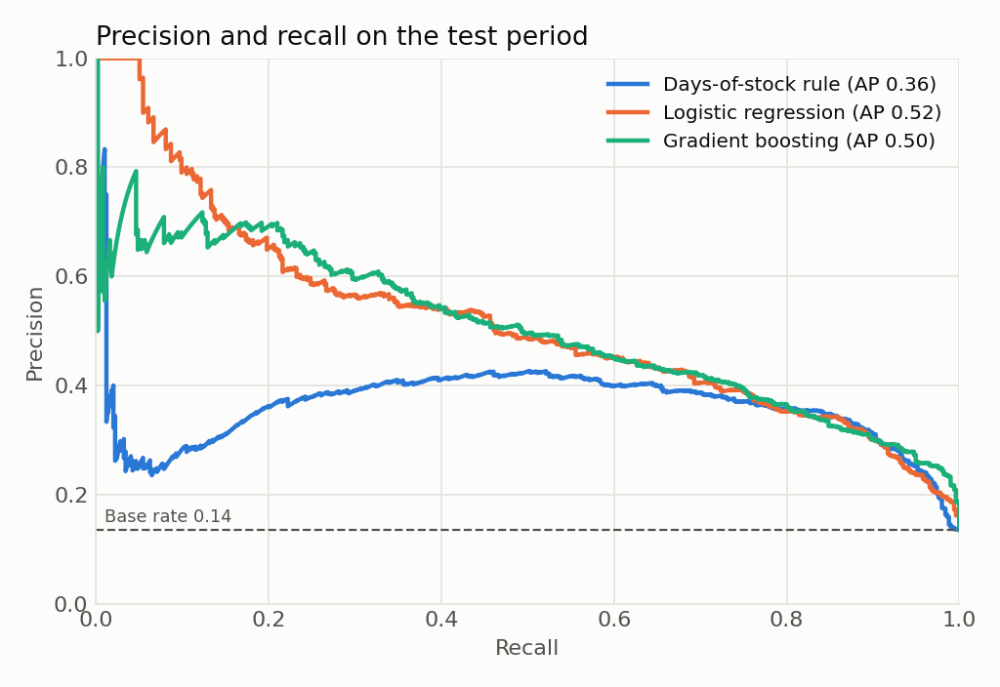
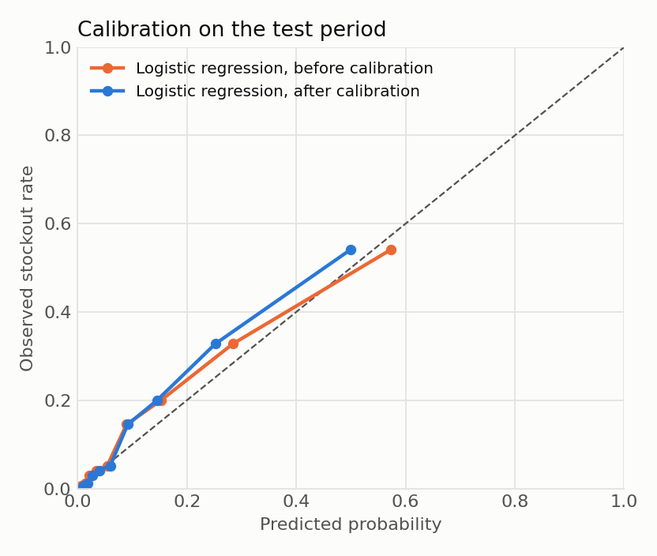
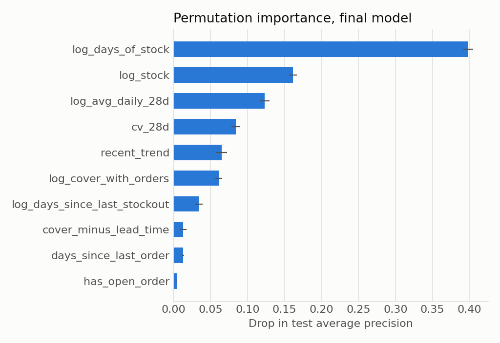

# Predicting pharmacy stockouts a week ahead

DSA 8401 Applied Machine Learning, capstone report. Nelson Mwangi, November 2026.

## 1. Problem

When a hospital pharmacy runs out of a medicine, patients are sent to buy it elsewhere or go without, and
clinicians switch to second-choice drugs. Most stockouts give some warning in the records: stock falls faster
than usual, an order is late, a supplier part-fills. Pharmacists rarely have time to read that warning across
hundreds of items.

The question this project answers: **for an item that is in stock at the start of a day, what is the
probability that it reaches zero usable stock on that day or any of the next six?** The output is a daily list,
highest risk first, for a pharmacist to review before placing orders or arranging transfers.

Framing choices:

- **Classification, not demand forecasting.** My earlier PharmaSight service forecast weekly demand per drug.
  A forecast still needs a stock, lead-time and receipt model on top before it says anything about a stockout,
  and errors in each part compound. Predicting the stockout directly targets the decision.
- **Seven-day horizon, scored at the start of the day.** Long enough to place an emergency order or borrow
  from another store, short enough that today's records say something about it.
- **Fixed review capacity.** The main operational metric assumes a pharmacist can check five items a day and
  asks how many stockout episodes get a warning first.
- **Only items in stock are scored.** An item already at zero needs a different response, not a prediction.

## 2. Data

### 2.1 Why synthetic

The proposal planned to use the hospital's dispensing, inventory and purchase-order records. Those records
cannot be placed in a public repository, and the course requires one. I wrote a simulator that produces the
same tables with the problems a real extract has, and built the pipeline against it. The pipeline is the part
that transfers: pointed at a real extract with the same five tables, it runs unchanged. The model and the
numbers in this report describe the simulator, not the hospital.

### 2.2 The simulator

`pipeline/simulate.py` simulates 80 items at one pharmacy store from 1 May 2024 to 28 February 2026.

Demand per item is overdispersed (negative binomial) around a level drawn per item, with weekend dips, annual
seasonality for about a third of items, and slow trends. Stock is replenished by a weekly order-up-to review.
The simulated pharmacist sees only what the system shows: the book balance, open orders and recorded
dispensing on in-stock days. Supplier lead times vary per item and per order, and outside shortages 12% of
orders are part-filled. Eight national shortages each hit about one item in eight for 20 to 75 days, during
which orders take two to four times longer and 40% are never delivered and are cancelled weeks later. In some months a budget
freeze stops ordering in the last week.

These are the recording problems built in, and how the pipeline handles each:

| Problem in the extract | Pipeline response |
|---|---|
| Receipts sometimes recorded in packs rather than units | Convert using the item's pack size |
| Lines keyed in error, then reversed days later | Drop both the line and its reversal |
| The same dispensing line exported twice | Drop duplicate line IDs |
| System outages: dispensing continues, lines are not entered | Detect from store-wide line counts; distrust balances until the next stock-take |
| Receipts keyed in days after the stock arrived | Book balance can go negative; those days are distrusted |
| Breakage and loss never recorded | Book balance drifts above true stock until a monthly stock-take adjusts it |
| Items added to the formulary mid-period | Each item's history starts at its opening balance |
| Items with no opening balance | Dropped; their stock cannot be rebuilt |
| Demand turned away during a stockout leaves no record | Not correctable; discussed under limitations |

### 2.3 From extract to model table

`pipeline/build_dataset.py` rebuilds each item's daily closing balance as opening balance plus receipts,
minus dispensing, transfers and expiries, plus stock-take adjustments. A store-wide outage is a day with fewer
than 30% of the trailing four-week median of dispensing lines. After an outage, an item's balance is
distrusted until its next stock-take adjustment; any negative balance is distrusted too.

| Step | Rows |
|---|---|
| Item-days with an opening balance (76 items) | 50,033 |
| After a 28-day warm-up for rolling features | 47,905 |
| Previous day's balance trusted | 39,173 |
| In stock at the start of the day | 33,478 |
| Label window complete and trusted | 31,192 |

The extract had 162,796 dispensing lines. The pipeline dropped 491 duplicate exports and 518 reversed pairs,
and converted 705 pack-unit records. It flagged 14 outage days, exactly the 14 the simulator injected. 17.5%
of item-days ended up distrusted. 10.1% of model rows are positive, and there are 552 stockout episodes.

### 2.4 The label, and how wrong it is

A stockout day is a trusted day whose rebuilt closing balance is zero. The label for day *t* is 1 if any of
days *t* to *t*+6 is a stockout day. A row is kept only if all seven days are trusted and observed.

Real records have no ground truth to check this against. The simulator does, so I measured it
(`reports/data_quality.json`). On trusted days, when the records say an item is out, it is out (precision
0.999). But records catch only 78% of true stockout days. The other 22% are days when unrecorded losses had
already emptied the shelf while the book still showed stock. On distrusted days, records catch only 34%, which
is why those days are excluded. In real data this miss rate is unknown, so record-based labels should be read
as a lower bound on how often items are really out.

## 3. Methods

### 3.1 Features

Each row describes what the system knew at the start of the day, using records up to the end of the previous
day: stock on hand, dispensing totals over 7 and 28 days and their daily variability, quantity on order and the
age of the oldest open order, days since the last order, the mean lead time of the last three deliveries,
stockout days in the last 90 and days since the last one. `pipeline/features.py` turns these into 16 model
features, among them days of stock (stock divided by average daily dispensing), cover including open orders,
cover minus recent lead time, recent trend, coefficient of variation, and calendar terms. The API calls the same
function, so serving cannot drift from training.

A test (`tests/test_pipeline.py`) rewrites everything in the extract after a cut-off date, rebuilds the table,
and checks that no feature dated on or before the cut-off changes. Another builds a hand-made extract where
one item runs out on a known day and checks the label is 1 for exactly the seven days before.

### 3.2 Validation design

Rows from the same item on nearby days are strongly correlated, so a random split would leak. Splits are by
date:

| Split | Dates | Rows | Positive rate |
|---|---|---|---|
| Train | 29 May 2024 to 24 June 2025 | 20,065 | 8.9% |
| Validation | 1 July to 25 October 2025 | 6,720 | 11.3% |
| Test | 1 November 2025 to 22 February 2026 | 3,658 | 13.5% |

A row stays in an earlier split only if its whole seven-day label window ends before the next split starts, so
no outcome day is shared across splits. Hyper-parameters, class weighting, calibration and the alert threshold
were all chosen on validation. The test period was scored once. It is small because an outage on 1 to 5
December 2025 left balances distrusted until each item's next stock-take, so December contributes no test rows
at all.

Confidence intervals for average precision resample whole items (200 bootstrap draws), since rows within an item
are not independent.

### 3.3 Models

- **Days-of-stock rule.** The baseline a pharmacist would use: rank items by stock divided by average daily use.
- **Logistic regression** with median imputation plus missing-value indicators and standardised inputs. Most
  features are log-transformed ratios, where a linear model is a fair first guess, and its coefficients can be
  explained to a pharmacist.
- **Gradient-boosted trees** (scikit-learn's histogram gradient boosting) to test whether interactions, such as
  low cover mattering more when lead times are long, add anything.

Each was tuned over a small grid (regularisation for logistic regression; learning rate and tree size for
boosting), with and without balanced class weights, and compared by average precision on validation. Average
precision is the headline metric because positives are about one row in ten and what matters is the top of the
ranking. The chosen model was then Platt-calibrated on validation so its probabilities can be read as risks.

### 3.4 What I left out, and why

- **Deep sequence models (LSTM, Transformers).** About 31,000 rows from 76 items. The snapshot features already
  summarise each item's recent history, and a sequence model would need far more series to learn that from raw
  days. It would also be harder to calibrate and to explain to the people acting on it.
- **XGBoost or LightGBM.** Scikit-learn's histogram gradient boosting uses the same kind of algorithm, and one
  fewer dependency keeps the container simpler. Boosting did not win here, so a faster implementation would not
  change the outcome.
- **Survival models.** Time to stockout is a natural survival target and would give a full risk curve. The
  decision here is a fixed one-week review, so a classifier answers it directly. It is a sensible extension.
- **Oversampling (SMOTE) or undersampling.** These change the base rate the model learns, which breaks
  calibration. Class weights were tried instead and lowered validation average precision in all 6 pairs of
  otherwise identical configurations.
- **Unsupervised anomaly detection.** Labels exist, so there is no reason to give them up.
- **Generative AI.** No text or unstructured input in this problem.
- **SHAP.** Permutation importance answers the question for 16 features without another dependency.
- **MLflow and a model registry.** One model and one dataset. `models/metadata.json` records what a registry
  entry would: version, parameters, features, threshold, data source and test metrics.

## 4. Results

### 4.1 Model selection on validation

| Model | Best configuration | Validation average precision |
|---|---|---|
| Days-of-stock rule | none | 0.274 |
| Logistic regression | C = 0.1, no class weights | 0.469 |
| Gradient-boosted trees | learning rate 0.05, 15 leaves, no class weights | 0.455 |

Logistic regression was chosen. All 12 configurations are in `reports/model_selection.csv`.

### 4.2 Test period

| Model | Average precision (95% CI) | ROC AUC | Brier score |
|---|---|---|---|
| Days-of-stock rule | 0.36 (0.28 to 0.45) | 0.84 | n/a |
| Logistic regression | 0.52 (0.43 to 0.61) | 0.87 | 0.088 |
| Gradient-boosted trees | 0.50 (0.41 to 0.62) | 0.88 | 0.088 |

Both learned models beat the rule on ranking. The intervals for the rule and logistic regression barely
overlap. Boosting and logistic regression are indistinguishable given the interval widths. The curves show
where the difference lies: at the top of the list, where the rule's precision is poor. The 5% of test rows the
rule ranks highest are items down to a median of 3 units, and 96% of them have an order on the way. Only a
quarter of those run out, because the delivery usually lands in time. The rule cannot see that. The model can,
through cover including open orders, and it also weighs how busy and how variable the item is.

### 4.3 Under a review budget

With five alerts a day (the top five items each morning):

| Model | Precision of alerts | Episodes warned (of 94) | Median warning |
|---|---|---|---|
| Days-of-stock rule | 0.38 | 66 (70%) | 1 day |
| Logistic regression | 0.46 | 66 (70%) | 1 day |
| Gradient-boosted trees | 0.44 | 63 (67%) | 2 days |

At three alerts a day the model warns of 56% of episodes against the rule's 53%; at ten a day, 88% against 90%.
So under a fixed budget the model does not find many more stockouts. Its gain is that fewer of the five daily
checks are wasted.

The comparison with a threshold rule is starker. "Review anything with under seven days of stock" raises 11.6
alerts a day on the test period, with precision 0.39 and recall 0.70. The model's review threshold, set on
validation for about five a day, raised 4.0 a day on test with precision 0.56 and recall 0.35. A pharmacist
facing twelve alerts a day where six in ten are false will start ignoring them.

Warnings come late: a median of one day before the stockout. Each morning the five slots go to items about to
run out, which crowds out items that will run out in five or six days. A seven-day label rewards exactly that.

### 4.4 Calibration

Logistic regression was already close to calibrated, and Platt scaling changed the Brier score from 0.0878 to
0.0881, which is no change in practice. Both slightly under-predict in the middle range, where the observed
stockout rate on test is a few points above the predicted one. The test positive rate (13.5%) is higher than
validation's (11.3%), which fits this.

### 4.5 Fast and slow movers

Items were split into thirds by average daily use in the training period.

| Demand tier | Test rows | Positive rate | Model AP | Rule AP |
|---|---|---|---|---|
| Slow | 1,240 | 11.0% | 0.42 | 0.27 |
| Medium | 1,270 | 9.7% | 0.43 | 0.31 |
| Fast | 1,148 | 20.6% | 0.68 | 0.52 |

The model is better than the rule in every tier, with the largest relative gain for slow movers. Fast movers
stock out twice as often and are easier to predict for both methods. A deployed list should not let fast
movers crowd out a slow-moving item that is clinically critical, which this model does not know about.

### 4.6 What drives the predictions

Shuffling days of stock costs 0.40 of test average precision, more than anything else. Stock level, demand
level, demand variability, recent trend and cover including open orders follow. The other order and
lead-time features (age of the oldest open order, recent lead time, days since the last order, whether any
order is open) contribute almost nothing. That surprised me, because the simulator includes supplier delays and
cancellations. I have not established why. One possibility is that weekly ordering puts nearly every low-stock
item on order (96% of the rule's top-ranked rows), so whether an order is open separates items poorly, and a
late order shows up as falling days of stock anyway. Permutation importance also understates features that are correlated with each
other, as cover and days of stock are.

## 5. Limitations

- **Synthetic data.** The model learned the simulator, and the simulator encodes my assumptions about demand,
  ordering and recording. The results say nothing about how well this would work at the hospital. What carries
  over is the pipeline, the validation design and the evaluation.
- **Labels come from records.** In the simulation, records missed 22% of true stockout days. Real records have
  no ground truth to measure this; a physical spot-check of shelf stock against the book would be needed.
- **Censored demand.** Dispensing during and after a stockout understates demand, so features built on it are
  biased low for items that recently ran out.
- **Excluded periods.** 17.5% of item-days were distrusted and dropped, including all of December 2025 in the
  test period. Distrusting balances until the next stock-take is conservative; a pharmacy that back-enters
  records after an outage would lose far less. If stockouts cluster after outages, the test results flatter
  the model.
- **Small test set.** 94 episodes and wide intervals. The threshold set for five alerts a day gave four on test.
- **Validation used twice.** The same period chose the model and fitted the calibration. The test period is
  untouched by either.
- **No clinical priority.** All items count the same. In practice a stockout of an antimalarial matters more
  than one of a vitamin.
- **The service does not monitor drift or retrain itself.** My earlier PharmaSight service had drift checks and
  champion-challenger retraining; I removed them because there is no live data stream to monitor yet.

## 6. Deployment

The trained model is served by a FastAPI app in a Docker container (`docker compose up -d --build api`). A
client sends a batch of item snapshots and gets back a calibrated probability, a review flag and days of
stock per item, highest risk first. The service:

- builds features with the same code as training and refuses to start if the model was trained on a different
  feature list;
- requires an API key, compared in constant time, and refuses to start in production with the default key;
- validates input at the boundary, rejecting items already at zero stock and impossible histories;
- runs as a non-root user with a container health check;
- loads the model once at startup and fails at startup if the artifacts are missing.

The full pipeline also runs inside Docker. Run there, it reproduced every metric in this report exactly.

## 7. Relevance and next steps

The tool fits an existing habit: a morning check of what to reorder. It replaces "sort by days of stock" with a
ranking that wastes fewer checks, and it gives each item a probability that means what it says.

Before this is worth anything at the hospital:

1. Run an aggregate audit of the real extract (counts only) to confirm stock balances are complete enough to
   rebuild, and agree the stockout definition with pharmacy staff.
2. Point the pipeline at a de-identified extract of the five tables and repeat the evaluation.
3. Run it silently for a few months: produce the daily list, don't act on it, and compare with what happened.
4. Try a label that rewards earlier warning, such as a stockout in days 3 to 10, and weight items by clinical
   priority.
5. Add drift monitoring once there is a live feed.
